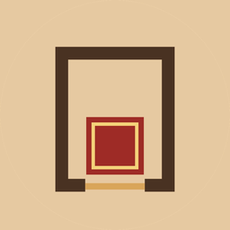
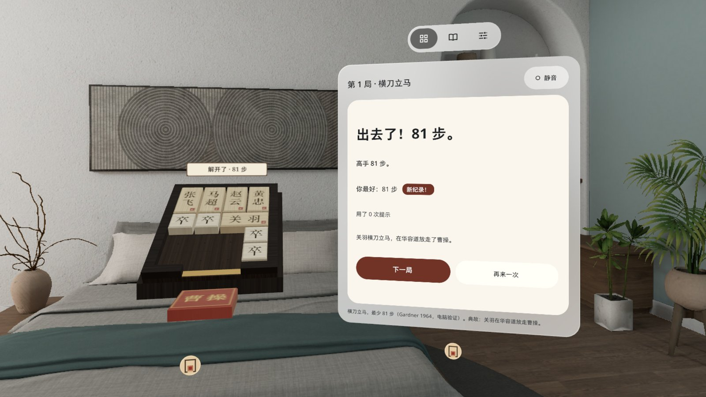
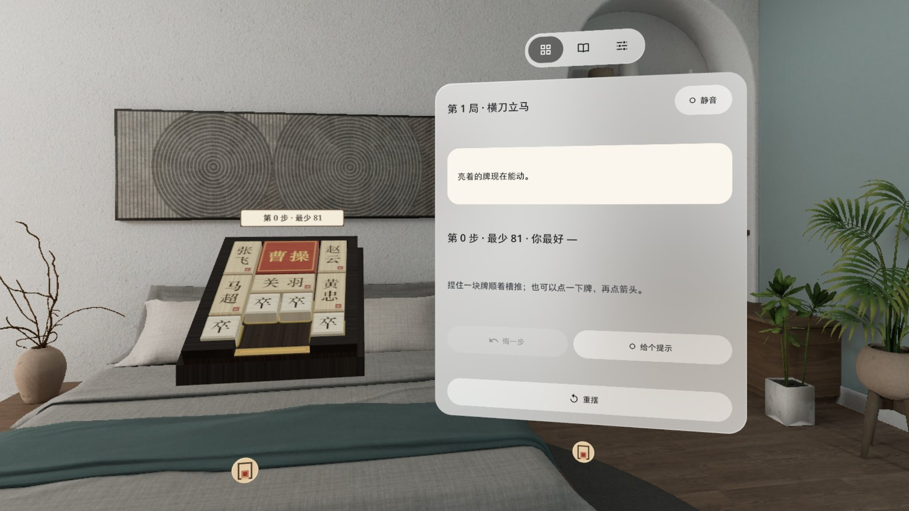
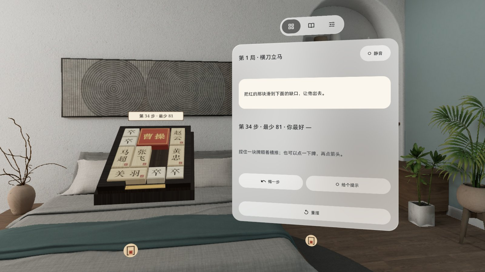
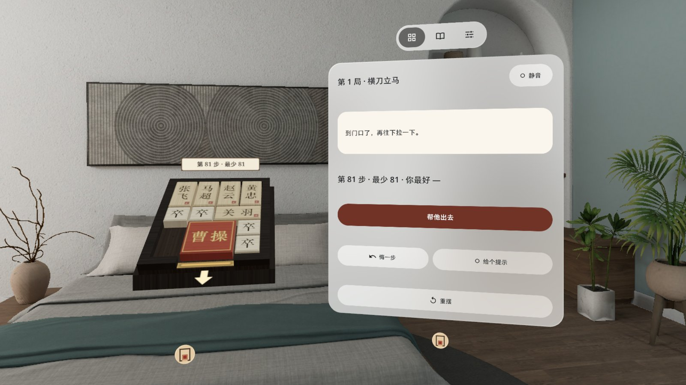
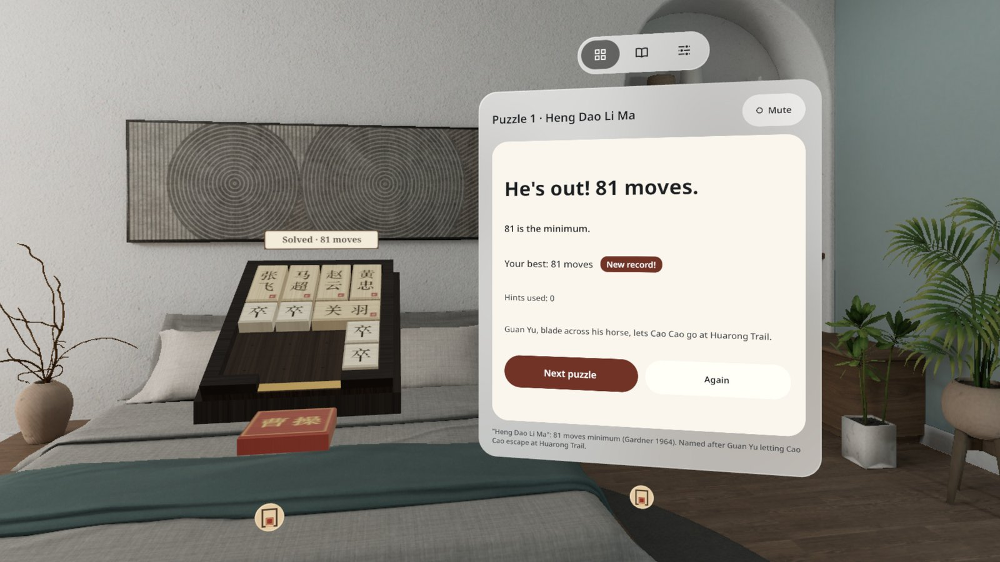
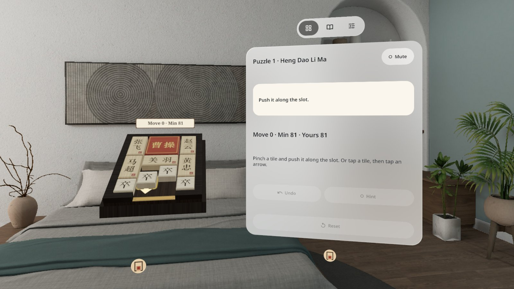
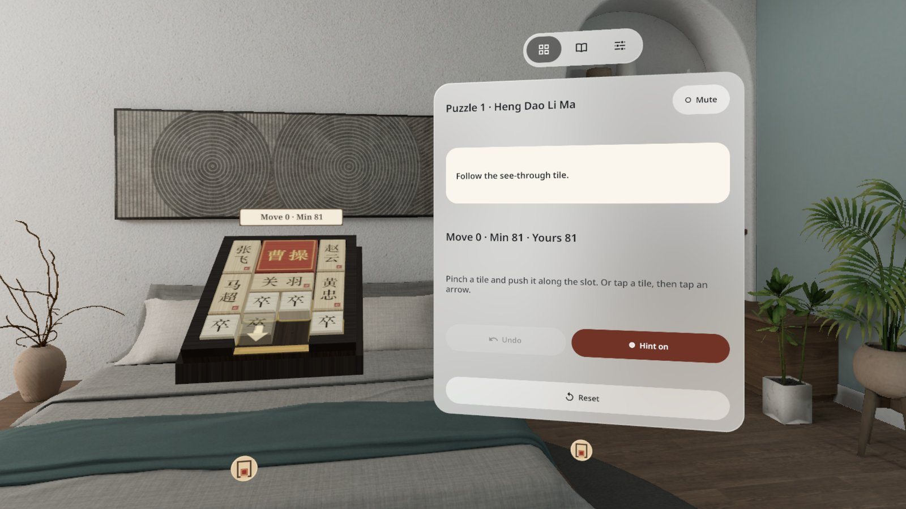

<p align="center"></p>

# 华容道 Klotski Box

**中文** | [English](#english)

桌上一只 1:1 的木盒华容道：十块木牌只能在盒槽里滑，把曹操从下面的缺口滑出去，他会真的掉到桌上。经典局「横刀立马」最少 81 步，看你几步。PICO OS 6 Shared Space（Spatial SDK）应用。



| | |
|---|---|
|  |  |
|  |  |
|  | |

### 玩法

- 捏住一块牌顺着槽推；也可以先点一下牌，再点空格上的箭头（箭头格 = 滑到底）
- 手势捏合、眼动注视 + 捏合、手柄射线三种输入都能玩
- 曹操到了缺口，再往下拉一下（或按 [帮他出去]），他滑出盒子、落到桌上
- 6 个经典局：横刀立马 81、左右布兵 54、齐头并进 60、指挥若定 70、桃花园中 70、兵分三路 72（最少步数都经求解器验证）
- [给个提示]：半透明的牌停在下一步的终点；[悔一步]、[重摆]；本机记录最佳步数
- 木盒倾角 0 / 30 / 45 / 60 / 90° 五档；木牌滑动、顶住、落格都有真实木头录音（CC0）
- 控制窗关掉后，捏一下牌就能叫回来；设置里有 [重开控制窗] 和 [退出应用]
- 中英双语，跟随系统语言，设置里可切换；全部本机运行，不联网、不需要账号

### 安装

```bash
adb install -r KlotskiBox-v0.1.1.apk
pico-cli app launch io.embodit.klotskibox
```

APK 在 [Releases](https://github.com/kejing-dev/KlotskiBox/releases)。Release 里的 `KlotskiBox-v0.1.1.apk` 是 `assembleRelease` 未签名包（给平台重签名用）；自己装到头显请用 `./gradlew assembleDebug` 出的 debug 包，或自行签名。

### 构建

```bash
./gradlew assembleDebug      # app/build/outputs/apk/debug/app-debug.apk
./gradlew testDebugUnitTest  # 求解器 / 拖动 / 布局单测
```

需要 JDK 17+、Android SDK 35。

### 说明

- 截图在 PICO 模拟器上拍摄；演示视频由调试命令驱动，**非真实手势录像**。
- 字体 Noto Sans（OFL，`third_party/noto-sans/OFL.txt`）；音效为 CC0 录音（freesound / Kenney）。

---

<a id="english"></a>

# Klotski Box

[中文](#华容道-klotski-box) | **English**

A life-size wooden Klotski box on your desk. Ten wooden tiles can only slide inside the box; slide Cao Cao (the big red tile) out through the gap at the bottom and he really drops onto the table. The classic "Heng Dao Li Ma" layout takes 81 moves at least. How many do you need? A PICO OS 6 Shared Space app (Spatial SDK).



| | |
|---|---|
|  |  |
|  |  |
|  | |

### How to play

- Pinch a tile and push it along the slot; or tap a tile, then tap an arrow on a free cell (the arrow cell = slide all the way)
- Hand pinch, eye gaze + pinch and controller ray all work
- When Cao Cao reaches the gap, pull him down once more (or press [Let him out]): he slides out of the box and drops onto the table
- 6 classic layouts: Heng Dao Li Ma 81, Zuo You Bu Bing 54, Qi Tou Bing Jin 60, Zhi Hui Ruo Ding 70, Tao Hua Yuan Zhong 70, Bing Fen San Lu 72 (minimums verified by the built-in solver)
- [Hint] shows a see-through tile where the next move ends; [Undo], [Reset]; your best move count is saved on the device
- Five box tilts: 0 / 30 / 45 / 60 / 90°; slides, bumps and snaps use real wood recordings (CC0)
- Closed the control panel? Pinch any tile to bring it back; Settings has [Reopen panel] and [Quit app]
- Chinese and English, follows the system language, switchable in Settings; fully offline, no account

### Install

```bash
adb install -r KlotskiBox-v0.1.1.apk
pico-cli app launch io.embodit.klotskibox
```

The APK is on [Releases](https://github.com/kejing-dev/KlotskiBox/releases). `KlotskiBox-v0.1.1.apk` there is the unsigned `assembleRelease` build (for platform re-signing); to sideload onto a headset, build `./gradlew assembleDebug` or sign it yourself.

### Build

```bash
./gradlew assembleDebug      # app/build/outputs/apk/debug/app-debug.apk
./gradlew testDebugUnitTest  # solver / drag / layout unit tests
```

Requires JDK 17+ and Android SDK 35.

### Notes

- Screenshots were taken on the PICO emulator; the demo video is driven by debug commands and is **not a recording of real hand gestures**.
- Font: Noto Sans (OFL, `third_party/noto-sans/OFL.txt`); sounds are CC0 recordings (freesound / Kenney).
